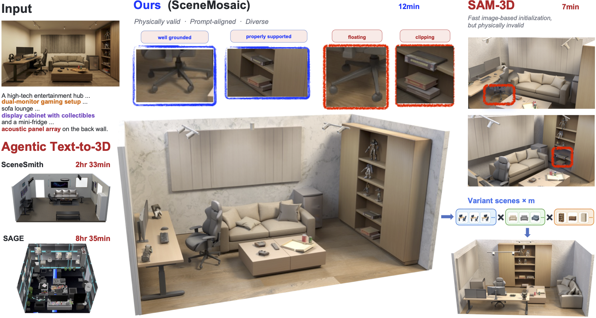

# SceneMosaic: Efficient and Diverse Simulation-Ready Scene Generation via Hybrid Agentic Layout Evolution

Xingjian Ran<sup>1,&ast;</sup>&nbsp;&nbsp;
Xiaoye Mo<sup>2,&ast;</sup>&nbsp;&nbsp;
Sihao Liu<sup>1</sup>&nbsp;&nbsp;
Jianyu Zhang<sup>1</sup>&nbsp;&nbsp;
Li Luo<sup>1</sup>&nbsp;&nbsp;
Bo Dai<sup>1,&dagger;</sup>

<sup>1</sup> The University of Hong Kong&nbsp;&nbsp;
<sup>2</sup> University of Electronic Science and Technology of China

<sup>&ast;</sup> Equal contribution.&nbsp;&nbsp;<sup>&dagger;</sup> Corresponding author.



SceneMosaic turns a single indoor image into a complete, editable 3D scene. The
pipeline runs perception, promptable segmentation, per-object 3D reconstruction,
inter-object relation extraction, and scene evolution, and publishes a set of
representative scene variants as `.glb` files.

## 1. Clone with the upstream submodules

`sam3` and `sam-3d-objects` are submodules pinned to the exact upstream commits
this project was validated against:

```bash
git clone --recurse-submodules https://github.com/rxjfighting/SceneMosaic.git
cd SceneMosaic
```

Already cloned without `--recurse-submodules`? Fetch them in place:

```bash
git submodule update --init
```

`sam3/` must contain `pyproject.toml` and `sam-3d-objects/` must contain
`environments/default.yml`. Upstream SAM3 `main` has since moved on to SAM 3.1,
whose inference code differs, so do not run `git submodule update --remote`
unless you intend to revalidate.

## 2. Prerequisites

- Linux x86-64 with Conda or Mamba.
- An NVIDIA GPU with at least 32 GB of VRAM for SAM 3D Objects inference
  (observed peak: about 38 GB for a single run).
- A system EGL runtime for headless rendering. On Ubuntu/Debian install
  `libegl1`, `libglvnd0`, and `libegl-mesa0` *before* creating the environments.
- Access approval for the gated
  [SAM3](https://huggingface.co/facebook/sam3) and
  [SAM 3D Objects](https://huggingface.co/facebook/sam-3d-objects)
  model repositories on Hugging Face.
- An API key for an OpenAI-compatible chat endpoint.

## 3. Create the environments

SceneMosaic runs from one environment, `scenemosaic`, and delegates segmentation
to a second, `sam3`. SAM3 and SAM 3D Objects have incompatible Python, PyTorch,
and CUDA dependency stacks, so they cannot share an interpreter. One installer
per environment:

```bash
bash scripts/install_scenemosaic.sh
bash scripts/install_sam3.sh
```

`scenemosaic` is the project environment; every command in the rest of this
document runs inside it. `sam3` holds nothing but the segmentation model — the
pipeline invokes its interpreter directly, and you never activate it by hand.
`install_scenemosaic.sh` also probes that PyOpenGL and pyrender can load EGL; if
that probe fails, install the system EGL packages from step 2 and rerun it.

Both names are defaults. `SCENEMOSAIC_ENV_NAME` and `SAM3_ENV_NAME` override
them, `SCENEMOSAIC_ENV_PREFIX` and `SAM3_ENV_PREFIX` install to an explicit Conda
prefix instead; pass whatever you choose to the configurator in step 6.

Behind a mirror or proxy, every package index is overridable:

```bash
SCENEMOSAIC_PIP_INDEX=https://mirror.example.com/simple bash scripts/install_sam3.sh
```

`SCENEMOSAIC_TORCH_INDEX` (`install_sam3.sh`), `SCENEMOSAIC_PIP_EXTRA_INDEX`, and
`SCENEMOSAIC_KAOLIN_FIND_LINKS` (`install_scenemosaic.sh`) work the same way.

## 4. Download model checkpoints

Authenticate once, after both gated repositories have granted access:

```bash
conda run -n scenemosaic python -m pip install "huggingface-hub[cli]<1.0"
conda run --no-capture-output -n scenemosaic hf auth login
mkdir -p checkpoints
```

SAM3 segmentation weights — listing the files explicitly avoids also pulling the
unused PyTorch checkpoint from the same repository:

```bash
conda run -n scenemosaic hf download facebook/sam3 \
  config.json merges.txt model.safetensors processor_config.json \
  special_tokens_map.json tokenizer.json tokenizer_config.json vocab.json \
  --repo-type model --local-dir checkpoints/sam3
```

SAM 3D Objects bundle — the staging directory preserves the upstream layout, so
move its nested `checkpoints/` into place:

```bash
conda run -n scenemosaic hf download facebook/sam-3d-objects \
  --repo-type model --local-dir checkpoints/sam3d-download \
  --max-workers 1 --include "checkpoints/*"
mv checkpoints/sam3d-download/checkpoints checkpoints/sam3d
```

The MoGe depth model and the DINOv2 Torch Hub directory:

```bash
conda run -n scenemosaic hf download Ruicheng/moge-vitl
conda run -n scenemosaic python -c \
  "import torch; torch.hub.set_dir(\"checkpoints/dinov2\"); torch.hub.load(\"facebookresearch/dinov2\", \"dinov2_vitl14_reg\", pretrained=True, trust_repo=True)"
```

Resulting layout:

```text
checkpoints/
  sam3/     config.json  model.safetensors  processor_config.json  ...
  sam3d/    pipeline.yaml  ss_generator.ckpt  slat_generator.ckpt  ...
  dinov2/   facebookresearch_dinov2_main/  checkpoints/*.pth
```

Checkpoint directories are untracked; never commit model weights or Hugging Face
tokens.

## 5. PBR materials (optional)

Skipping this step is safe: room surfaces then fall back to the single bundled
material in `data/materials/Marble001/`. Complete it to enable automatic
text-to-material retrieval, which picks a different material per surface.

```bash
conda run -n scenemosaic python scripts/download_ambientcg.py \
  --resolution 2K --format PNG --dry-run          # add --limit 5 for a smoke test
conda run -n scenemosaic python scripts/download_ambientcg.py \
  --resolution 2K --format PNG
conda run -n scenemosaic python scripts/compute_ambientcg_embeddings.py
```

ambientCG encodes resolution and format in every texture filename
(`<asset>_2K-PNG_Color.png`), so the whole pipeline must agree on one pair.
`2K`/`PNG` is the default everywhere; to use another variant, set it once so the
tools the pipeline invokes internally agree too:

```bash
export SCENEMOSAIC_MATERIAL_FORMAT=JPG      # also SCENEMOSAIC_MATERIAL_RESOLUTION
```

Pass `--overwrite` to regenerate existing embeddings.

## 6. Configure the runtime and API access

The configurator locates both named Conda environments and writes their resolved
interpreter paths, so no Conda path is ever copied by hand:

```bash
mkdir -p workspace/perception_attempts
python scripts/configure_runtime.py
```

One API key serves perception, relation extraction, and evolution. A custom
OpenAI-compatible gateway is optional; when `OPENAI_BASE_URL` is unset all three
stages use the official OpenAI endpoint:

```bash
export OPENAI_API_KEY="replace-with-your-key"
# Optional, for an OpenAI-compatible gateway:
# export OPENAI_BASE_URL="https://gateway.example/v1"

conda run -n scenemosaic python -m vlm_agent.cli verify
```

`verify` exits non-zero and names the failing check if anything is missing.
`configs/runtime.local.json` is machine-local and untracked; it holds resolved
interpreter paths and the *names* of the environment variables the pipeline
reads, never credential values. Rerun the configurator with `--overwrite` after
replacing an environment.

## 7. Run the end-to-end demo

Four input images ship in [examples/](examples/README.md):

```bash
conda run --no-capture-output -n scenemosaic \
  python examples/run_end_to_end.py \
  --example scene_092 \
  --scene-name scene_092_demo
```

Selectors: `scene_018`, `scene_031`, `scene_092`, `gaminglounge`. For your own
image, replace `--example <name>` with `--input-image path/to/image.png`; an
explicit `--scene-name` is always required.

Results land in `workspace/runs/<scene-name>/`, with the published variants at
`outputs/representative_scenes/scene_01..06.glb`.

Inspect any run:

```bash
conda run -n scenemosaic python -m vlm_agent.cli \
  --runtime-config configs/runtime.local.json \
  status --scene-root workspace/runs/scene_092_demo
```

## 8. Resume an interrupted run

Recovery is stage-level. Point `run` at the existing scene root:

```bash
conda run --no-capture-output -n scenemosaic \
  python -m vlm_agent.cli \
  --runtime-config configs/runtime.local.json \
  run --scene-root workspace/runs/<scene-name>
```

A valid perception publication, SAM3D output, relation publication, or completed
scene is reused instead of recomputed; failed attempts are retained for
inspection and never overwritten. An evolution failure therefore reuses
perception, SAM3D, and relations but reruns evolution from the start.

If perception stopped after a reusable Pass A / SAM3-A prefix, select that
attempt explicitly:

```bash
conda run --no-capture-output -n scenemosaic \
  python -m vlm_agent.cli \
  --runtime-config configs/runtime.local.json \
  run --scene-root workspace/runs/<scene-name> \
  --perception-reuse-local-pre-pass-b-cache-root \
  workspace/perception_attempts/<perception-attempt>
```
